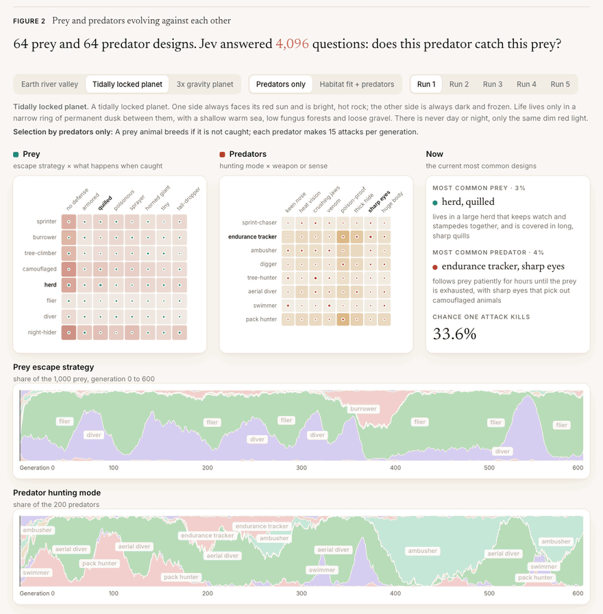
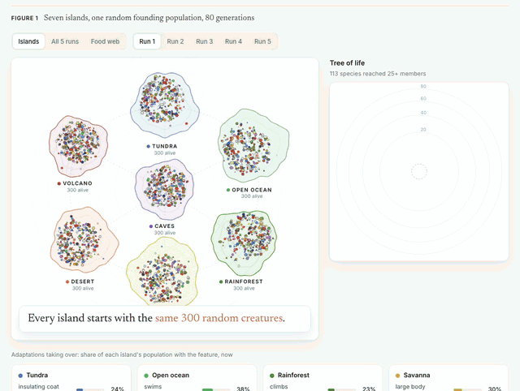
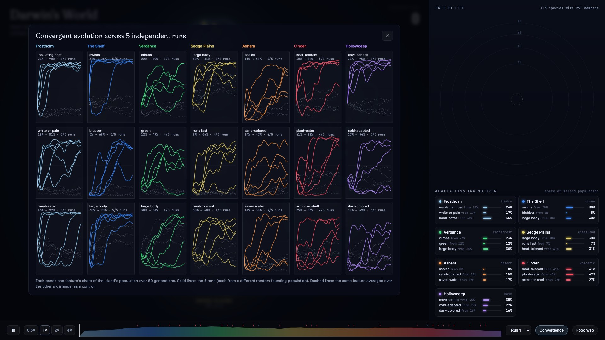

# Darwin's World

An evolution simulation whose only law of nature is a judgment model's yes-or-no answers: it reproduces the adaptations
the model's common sense expects, and a sustained predator-prey arms race appears only when predators alone decide which
prey breed.



Live demo: <LIVE_URL>

Creatures are written in plain English ("a coat of hollow hairs that trap warm air"). [Jev](https://docs.typesafe.ai),
TypeSafe's judgment model, answers narrow questions such as "could this creature survive the polar winter?" or "does
this predator usually catch and eat this prey?" with a probability. Survival, breeding and mutation are ordinary Python
that never reads what a phrase means.

## Results

| Question | Answer | Number |
|---|---|---|
| What evolves when the model's common sense is the physics? | What that common sense expects | Tundra island: insulating coats 21% → 86–95% and pale colour 18% → 71–89% of the population, 5 of 5 runs (16% and 8% on the other six islands) |
| Does anything appear that no single question asked for? | Only under the rule chosen second | Selection by predators only: the most common prey design changes 6–13 times per 600 generations (15 of 15 runs) vs 0–5 in 30 control runs |
| Is it an arms race, or drift? | An arms race (time-shift test) | Predators from 20 generations later kill today's prey 0.37–1.87 percentage points more often than predators from 20 generations earlier, 15 of 15 runs; controls within ±0.05 |
| What happens under the first rule (habitat fit + predators)? | No arms race; a hill-climb | 0 changes in 13 of 15 runs; same final prey as both controls in 15 of 15 |
| How much of the model's pairwise answers is per-animal? | Most of it | An additive "predator score + prey score" fit explains 67–80% of the variance (logit scale), by world |
| Cost | | USD 8.27 for about 1.43 million questions, model `jev-1.13.0` |

Caveat in one line: the arms race depends on a selection rule I chose after the first rule failed, and the model has
read about real animals, so none of this is evidence about biology.

## How it works

**Part 1: seven islands.** Seven islands (tundra, open ocean, rainforest, savanna, desert, volcano, caves) start with the
same 300 random creatures, each 8 phrases (size, coat, colour, diet, movement, activity time, behaviour, physiology) from
a hand-written pool of 394. Each generation, on every island (`darwin/sim.py`):

1. **Encounters.** Each meat-eater meets 2 random neighbours. Jev: "could the first creature catch and eat the second?"
   The kill happens with probability 0.7 × p².
2. **Survival.** Jev answers three questions with the island's description as context: food, daily habitat, and the
   island's hard season (a nine-month polar winter, a two-year drought, an eruption). Fitness is the geometric mean of
   the three; survival probability is 0.12 + 0.88 × fitness^1.5. Creatures die of old age after 5 generations.
3. **Breeding.** Survivors refill the island to 300; parents are drawn in proportion to fitness squared, 80% within
   the same species. Each of the child's 8 phrases comes from one parent and mutates with probability 0.06.
4. **Migration.** 0.4% of creatures per generation drift to a neighbouring island (1.2% for swimmers and fliers).

Five runs of 80 generations each, about 450,000 creatures in total.

**Part 2: the arms race.** Prey and predators each have 64 designs, two phrases each:

```
prey      = escape strategy (8) x what happens when caught (8)   = 64 designs
predator  = hunting mode (8)    x weapon or sense (8)            = 64 designs
Jev, per world: 4,096 "does this predator usually catch and eat this prey?" + 128 habitat-fit questions
code:  hunting, breeding, mutation (darwin/arms.py); nothing in it knows what a phrase means
```

Each generation, each predator makes 15 attacks on random prey; an attack by predator i on prey j kills with probability
equal to Jev's answer for that pair. Surviving prey breed back to 1,000; predators breed back to 200 in proportion to
kills + 0.25. Each child phrase mutates with probability 0.01. Three worlds change the answers: an Earth river valley, a
tidally locked planet and a 3x-gravity planet. 600 generations, 5 seeds per world and condition.

Two selection rules, both reported:

- **Habitat fit + predators** (run first): breeding is also weighted by the square of Jev's habitat-fit answer ("could
  this animal find food and raise young here?"), and predators make 5 attacks per generation.
- **Predators only** (run second): a prey animal breeds if it is not caught; 15 attacks per predator per generation.

Three controls run on the same code and seeds:

- **No-interaction table:** Jev's 4,096 answers replaced by their best additive fit, `logit(p) = predator score + prey
  score`. It keeps everything per-animal scores can say and removes every predator-prey interaction.
- **Fixed predators:** a fresh, even mix of predators every generation, so prey face an environment that does not evolve.
- **Shuffled answers:** Jev's values randomly reassigned to pairs; same distribution, no meaning.

Measurements: a **change** is the most common prey design being replaced after generation 100 and the new one holding
for 10+ generations. The **time-shift test** compares the kill rate of predators from 20 generations in the future
against today's prey with that of predators from 20 generations in the past; a positive gap means predators keep adapting
to prey that keep changing, the standard signature of an ongoing arms race.

| World | Changes per run: Jev | No-interaction | Fixed predators | Shuffled | Time-shift gap, Jev (pp) | Time-shift gap, controls (pp) |
|---|---|---|---|---|---|---|
| Earth river valley | 13, 12, 6, 13, 8 | 0, 3, 1, 0, 3 | 5, 5, 0, 2, 2 | 19 to 24 | +0.96 to +1.48 | −0.02 to +0.02 |
| Tidally locked planet | 11, 12, 9, 7, 10 | 0 in 5 of 5 | 0 in 5 of 5 | 13 to 20 | +0.65 to +1.87 | −0.02 to +0.01 |
| 3x gravity planet | 6, 10, 6, 10, 6 | 0 in 5 of 5 | 0 in 5 of 5 | 17 to 21 | +0.37 to +1.05 | −0.02 to +0.05 |

Selection by predators only. Controls column: no-interaction and fixed-predator runs. Source: `runs/arms/index.json`.

## Why it isn't circular

The fair critique of Part 1 is that each island's fitness is a fixed function of one genome. Evolution there is a slow
hill-climb to whatever Jev rates highest, and nothing appears that a single question did not already contain. Part 2
tests whether anything more comes out, and the honest answer has two halves:

- **Under the first rule, the critique holds.** With habitat fit in the breeding weight, prey settle on one design and
  stay: 0 changes in 13 of 15 runs, a time-shift gap of −0.11 to +0.12 pp, and the same final prey as the no-interaction
  and fixed-predator controls in 15 of 15 runs. On Earth and the tidally locked planet that design is simply the one with
  the best habitat-fit score. Habitat fit outweighs predation, so this is a hill-climb.
- **I chose the predators-only rule after the first rule produced no arms race.** It is reported as a second rule, not a
  replacement; both are in the data and the figure, and the constants were not tuned further. Under it, a prey design's
  value depends on which predators exist now, and the reverse, so there is no fixed optimum unless Jev's answers collapse
  into one. They do not: the cycles disappear when the pairwise interactions are removed (no-interaction table) or when
  predators stop evolving (fixed predators).
- **A random table cycles more** (13–24 changes, gap +2.9 to +5.2 pp), because noise is all interaction. Jev's table is
  far more structured (additive fit 0.67–0.80 vs 0.03 for a hash-based mock), and its cycles follow sensible pairs: on
  the tidally locked planet, seed 1, the most common prey changes 11 times, 9 of them between "flier, tiny" and
  "diver, tiny", while aerial divers are the most common predator for most of the run.
- The design a fixed fitness function would pick (safest against an average predator) is the most common prey in only
  8–31% of generations on Earth and at 3x gravity, and 64–73% on the tidally locked planet.

The claim is narrow: Jev's pairwise answers contain interactions that per-animal scores cannot express, and those
interactions sustain coevolution when selection depends on them.

## Part 1 detail: what converged and what did not



Share of each island's population with a feature, at the start and averaged over the last 5 generations of each run:

| Island | Feature | Start | End, runs 1 / 2 / 3 / 4 / 5 | Other 6 islands (end) |
|---|---|---|---|---|
| Tundra | insulating coat (thick fur, blubber, down) | 21% | 90 / 89 / 90 / 95 / 86% | 16% |
| Tundra | white or pale colour | 18% | 71 / 74 / 88 / 89 / 82% | 8% |
| Tundra | cold physiology (fat stores, antifreeze, compact body) | 27% | 89 / 95 / 86 / 91 / 61% | 22% |
| Open ocean | swims (fins, flippers, gills) | 36% | 96 / 94 / 96 / 99 / 97% | 21% |
| Open ocean | blubber | 5% | 31 / 78 / 79 / 79 / 79% | 9% |
| Caves | cave senses (blind, echolocation, whiskers, antennae) | 30% | 95 / 90 / 99 / 94 / 98% | 21% |
| Volcano | heat tolerance | 30% | 58 / 91 / 95 / 95 / 98% | 28% |
| Rainforest | climbs | 22% | 45 / 59 / 93 / 94 / 53% | 21% |
| Savanna | runs fast | 9% | 81 / 76 / 90 / 16 / 66% | 6% |

At the end of every run, 79–88% of the tundra population has both an insulating coat and a large body. A typical
survivor from run 1: *"the size of a bear, a coat of hollow hairs that trap warm air, pale silver-grey, eats seals and
large fish, walks slowly on four stout legs, active through the long polar night"*.

What did not converge:

- **Deserts did not evolve nocturnal burrowers.** Water-saving physiology rose in 3 of 5 runs (to 86–89%); nocturnality
  fell in 4 of 5; burrowing passed 50% in no run.
- **Large bodies win everywhere** (63% across islands): Jev rarely judges that a small predator can catch a rhino-sized
  creature, so size is a universal defence.
- Colour tracks habitat only where Jev's judgments make it matter (white on the tundra, green in 4 of 5 rainforest runs).
  No rule mentions camouflage.

Per run: about 100 species reach 25+ members, about 75 of them go extinct, 24,000–36,000 creatures are eaten, and about
1,200 migrate. Videos: [`docs/darwins-world.mp4`](docs/darwins-world.mp4) (arms race, 35 s),
[`docs/islands.mp4`](docs/islands.mp4) (islands, 40 s).



## Reproduce

Everything below is free and needs no API key: every Jev answer behind both parts is committed
(`runs/arms/physics_*.json`, 12,672 answers; `cache/island_answers.tsv.gz`, 1.4 million answers, 10 MB). Python 3.9+,
standard library only.

```bash
git clone https://github.com/isaacbitran/darwins-world && cd darwins-world
python3 -m http.server 8765                          # study page: http://localhost:8765/web/
python3 darwin/arms.py --world locked --seeds 1-5    # all rules and controls for one world from the committed answers, ~1 min
python3 darwin/arms_index.py                         # rebuilds runs/arms/index.json and prints every Part 2 number
python3 darwin/sim.py --seed 1 --gens 80 --K 300 --n0 300   # replays island run 1 exactly from the committed answers, ~10 s
python3 darwin/summarize.py                          # recomputes the Part 1 table from runs/seed*.json
```

`sim.py` with seeds 1–5 reproduces the data in `runs/seed1.json` … `runs/seed5.json` exactly, with zero Jev calls.

Mock mode (`JEV_MOCK=1`) replaces every Jev call with a deterministic hash-based probability. It needs no key and spends
nothing; its output only checks that the code runs:

```bash
JEV_MOCK=1 python3 darwin/arms_physics.py --world heavy --out /tmp/mock_physics.json
JEV_MOCK=1 python3 darwin/arms.py --world heavy --physics /tmp/mock_physics.json --seeds 1-2 --gens 150 --out /tmp/mock_arms.json
JEV_MOCK=1 python3 darwin/sim.py --seed 1 --gens 3 --K 60 --n0 60 --out /tmp/mock.json
```

New questions need a TypeSafe API key:

```bash
cp .env.example .env                                  # put TYPESAFE_API_KEY=... in .env (gitignored)
python3 darwin/arms_physics.py --world savanna        # 4,224 questions, ~USD 0.015; skips anything already answered
python3 darwin/sim.py --seed 6 --gens 80 --K 300 --n0 300     # a new island run, ~2 min, ~USD 1.50
```

Each call is logged locally to `ledger.jsonl` (tokens, latency; gitignored). `arms_physics.py` refuses to call Jev once
the ledger total passes `JEV_LEDGER_CAP` (USD, default 8.55), and `sim.py --budget` stops a run the same way. To add a
world, add its description to `WORLDS` in `darwin/arms_physics.py`, fetch it, run `arms.py --world <name>`, and add it to
`NAMES` in `darwin/arms_index.py`.

Rendering the GIFs and videos needs `requirements.txt` (Playwright with Chromium, imageio-ffmpeg) and the static server:

```bash
python3 -m venv .venv && .venv/bin/pip install -r requirements.txt && .venv/bin/playwright install chromium
.venv/bin/python darwin/render_arms.py      # docs/hero.gif + docs/darwins-world.mp4 from Part 2 of the page
.venv/bin/python darwin/render_arms.py --shot /tmp/v.png --q "world=heavy&rules=default&seed=3" --t 300
.venv/bin/python darwin/render_video.py     # docs/islands.mp4 + docs/islands.gif from Part 1
```

**Cost.** Total spend USD 8.27 for about 1.43 million questions on `jev-1.13.0`: five island runs at USD 1.45–2.00 each,
early calibration runs, and USD 0.046 for the arms race's 12,672 questions. A typical island call carries about 100
questions and 13,000 input tokens; median latency was 191 ms.

**Deploy.** The study page is static. `vercel.json` serves `web/index.html` at the root and the run data from `runs/`;
there is no build step.

## Limitations

- The arms race appears only under the predators-only rule, which I chose after the first rule produced none.
- Jev's table is 67–80% additive. The interaction part is real but smaller than in a random table, so its cycles are
  slower and fewer than the shuffled control's.
- One hand-written set of phrases (8 × 8 for Part 2, 394 for Part 1) and a handful of world descriptions; different
  phrases would give different tables.
- Jev has read about real animals. Both parts test whether its common sense is coherent enough to drive selection;
  neither is evidence about biology.
- Five seeds per condition; populations of 1,000 prey and 200 predators, so drift is visible in the controls (up to 5
  changes with fixed predators on Earth).

## Prior art

Artificial-life systems such as Tierra (Ray 1991), Avida (Ofria and Wilke 2004), Polyworld (Yaeger 1994) and Sims'
evolved virtual creatures (Sims 1994) use numeric or program genomes and hand-coded physics. Recent work puts large
models inside evolution in two other roles: as **variation operators** that write or mutate code (Evolution through Large
Models, Lehman et al. 2022; OpenELM) and as **judges of a whole simulation** against a target description (ASAL, Kumar et
al. 2024). Here the model is neither: it is the environment. It sets no target, writes no genomes, and answers narrow
questions about one creature or one pair at a time. The time-shift test follows the host-parasite coevolution
literature (Gaba and Ebert 2009; Blanquart and Gandon 2013). I did not find earlier work that uses a judgment model as
the physics of an evolution simulation over natural-language genomes; a short search is not proof that none exists.

## Repository map

```
web/index.html          study page (Part 1: islands.js, Part 2: arms.js, shell: study.js, styles: css/)
darwin/sim.py           Part 1 simulation: encounters, survival, breeding, migration, species
darwin/traits.py        394-phrase trait pool with measurement-only tags (Jev never sees the tags)
darwin/islands.py       seven island descriptions (the context Jev sees), seasons, neighbours
darwin/summarize.py     Part 1 cross-run measurement -> runs/summary.json; report.py prints one run
darwin/arms_physics.py  Part 2 phrases, world descriptions, the 4,224 questions per world -> runs/arms/physics_*.json
darwin/arms.py          Part 2 coevolution, both selection rules, the three controls, measurements
darwin/arms_index.py    Part 2 cross-world summary -> runs/arms/index.json
darwin/jev.py           batched Jev client, local spend ledger, JEV_MOCK offline mode
darwin/probe.py         calibration probe used before the first run
darwin/render_*.py      headless renders of the page -> docs/ GIFs and videos
runs/                   five island runs (seed1-5.json + logs), summary.json; runs/arms/ all Part 2 runs and answers
cache/                  island_answers.tsv.gz: every Part 1 answer (kind, island, genome(s), probability)
docs/                   GIFs, videos, convergence figure
vercel.json             static deploy of the study page
```

## License

MIT. See [LICENSE](LICENSE).
